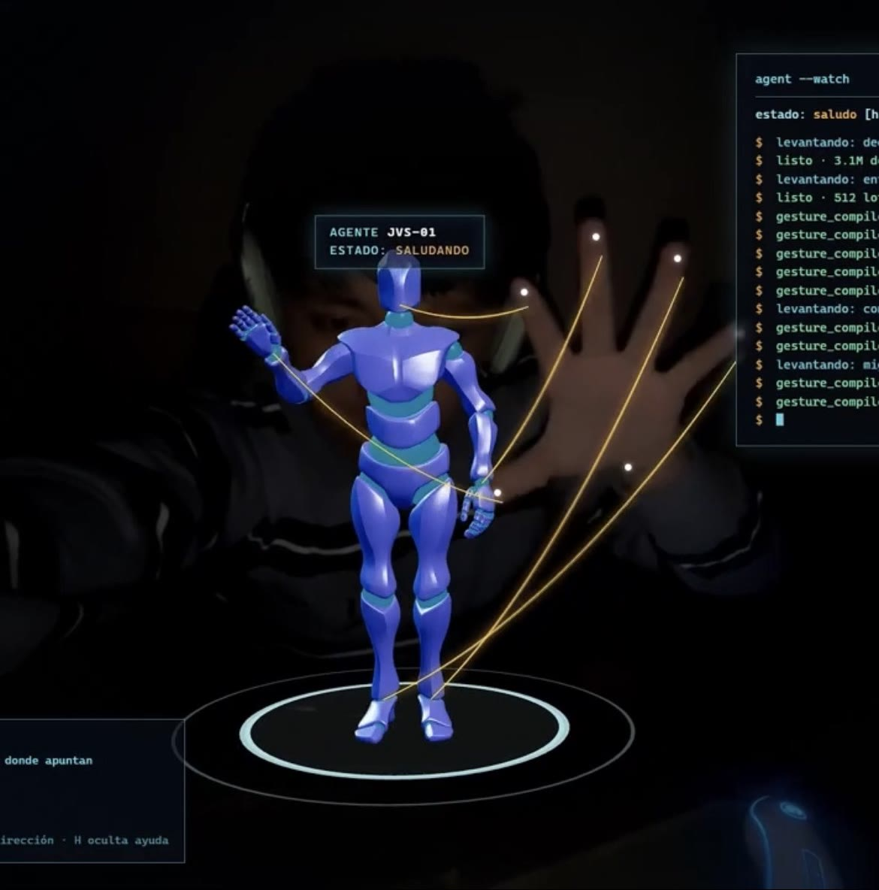
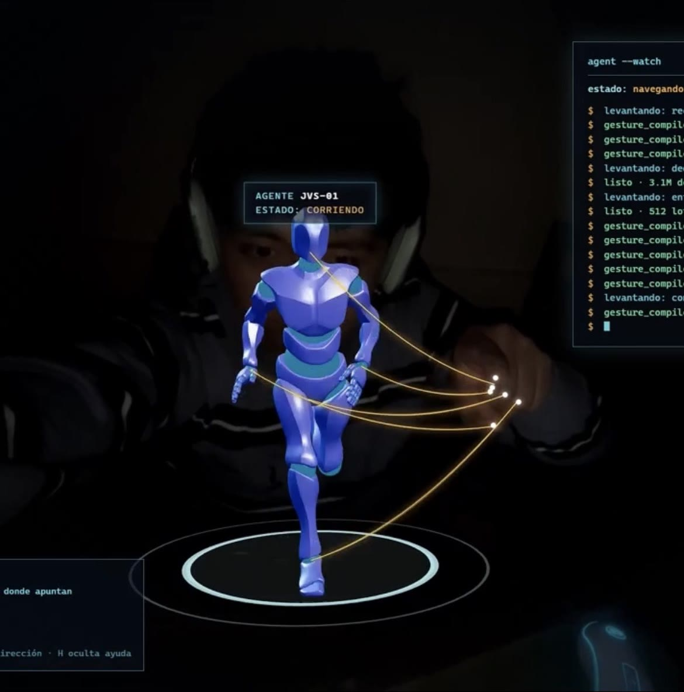

# Gesture Puppet · Control con la mano

Un personaje 3D que obedece los gestos de tu mano en tiempo real, unido a tus dedos con hilos de marioneta.
Funciona todo en el navegador con la cámara web: **MediaPipe** rastrea la mano y **three.js** dibuja el 3D.
Ningún cuadro de la cámara sale de tu computadora.

<p align="center">
  
</p>

## En acción

| Palma abierta → saluda | Solo índice → corre |
|---|---|
|  |  |
| Muestro la palma con los cinco dedos abiertos. Cada yema (punto blanco) lanza un hilo hacia la cabeza, las manos y los pies del agente, que levanta el brazo y saluda. La terminal de la derecha registra el cambio de estado. | Dejo solo el índice estirado y el agente corre hacia donde apunta. Los hilos siguen a mis dedos en tiempo real y la etiqueta sobre su cabeza pasa a **CORRIENDO**. |

## Gestos

| Gesto | Acción |
|---|---|
| ✋ Palma abierta | Saluda |
| ✌ Índice + corazón | Camina hacia donde apuntan los dedos |
| ☝ Solo índice | Corre hacia donde apunta |
| ✊ Puño | «Carga pesada» (golpea mientras la terminal procesa tareas) |
| 👌 Pinza (pulgar + índice) | Salta |
| Sin mano | Se queda en reposo mirando a la cámara |

¿No tienes cámara? Usa el **modo teclado**: teclas `0`-`5` para los gestos, flechas o `WASD` para la dirección, `H` oculta la ayuda.

## Pruébalo tú

Necesitas Python 3 (solo para el servidor local) y un navegador moderno (Chrome, Edge o Firefox).

1. Clona el repo:
   ```bash
   git clone https://github.com/Nobody2077/gesture-puppet.git
   ```
2. Descarga el personaje y las animaciones gratis de Mixamo y ponlos en `assets/`.
   Están los pasos en [`assets/LEEME.md`](assets/LEEME.md). No vienen incluidos porque su licencia no permite redistribuirlos.
3. En Windows, doble clic en `iniciar.bat`. En cualquier sistema también sirve:
   ```bash
   python servidor.py
   ```
   y abrir http://localhost:8000
4. Pulsa **Iniciar con cámara**, acepta el permiso y muestra la mano con buena luz, a unos 40-80 cm.

> No abras `index.html` con doble clic: desde `file://` los navegadores bloquean los módulos de JavaScript y la cámara.

## Cómo lo hice

**1. Rastrear la mano.** MediaPipe Hand Landmarker devuelve 21 puntos de la mano en cada cuadro del video
(muñeca, nudillos, articulaciones y yemas). Lo ejecuto en modo `VIDEO` en la GPU, y si falla pasa solo a la CPU.

**2. Reconocer el gesto sin entrenar ningún modelo** (`js/gestures.js`). Uso geometría simple:
un dedo está *estirado* si su yema está al menos 12 % más lejos de la muñeca que su articulación del medio.
Con eso sé qué dedos están abiertos y lo traduzco a un gesto. La pinza se detecta cuando la distancia
pulgar-índice es menor al 30 % del tamaño de la palma, así funciona igual cerca o lejos de la cámara.

**3. Evitar que tiemble.** MediaPipe a veces se equivoca en un cuadro suelto. Un filtro temporal
(`GestureFilter`) solo acepta un gesto cuando se repite 3 cuadros seguidos, y da la mano por perdida tras 10 cuadros sin verla.
Además, los puntos se suavizan con un promedio exponencial antes de dibujar los hilos.

**4. Dirección del movimiento.** Con ✌ o ☝ calculo el vector desde la base de los dedos hasta las yemas,
lo invierto en X (la cámara se ve en espejo) y el personaje gira suavemente por el camino más corto hacia ese ángulo.

**5. Animar al personaje** (`js/character.js`). El modelo y las 6 animaciones son FBX de Mixamo que cargo con
`FBXLoader` y mezclo con `AnimationMixer`, con transiciones de 0,25 s. Las animaciones de Mixamo traen su propio
desplazamiento de cadera, así que lo borro (`#stripRootMotion`) para que sea el código quien mueve al personaje.

**6. Los hilos de marioneta** (`js/strings.js`). Proyecto la posición 3D de la cabeza, las manos y los pies a la pantalla
y dibujo, desde cada yema, una curva que cuelga un poco como una cuerda real, en un `<canvas>` 2D encima del 3D.

**7. Todo local.** three.js y MediaPipe están en `vendor/` (sin CDN), y `servidor.py` corrige los tipos MIME
que Windows suele dar mal para `.wasm` y `.mjs`.

## Estructura

```
index.html          página principal
iniciar.bat         abre el servidor local y el navegador (Windows)
servidor.py         servidor local con los tipos MIME correctos
css/style.css       estilo del HUD
js/main.js          orquestación: cámara, MediaPipe, bucle principal
js/gestures.js      clasificador de gestos y filtro temporal
js/character.js     carga del FBX, animaciones, movimiento
js/strings.js       hilos de marioneta (canvas 2D)
js/hud.js           terminal y etiqueta del agente
assets/             aquí van los FBX de Mixamo (ver assets/LEEME.md)
vendor/             three.js r170 y MediaPipe Tasks Vision
docs/               capturas del README
```

## Ajustes rápidos

- Sensibilidad del gesto: `GestureFilter({ need, lostAfter })` en `js/main.js`.
- Velocidades: `SPEED` en `js/character.js`. Transición entre animaciones: `FADE`.
- Umbral de la pinza: `0.3` en `classify()` de `js/gestures.js`.

## Modo sin internet (opcional)

El detector de manos (`hand_landmarker.task`, ~7 MB) se descarga de Google la primera vez. Para usarlo sin internet,
descárgalo desde
https://storage.googleapis.com/mediapipe-models/hand_landmarker/hand_landmarker/float16/1/hand_landmarker.task
y guárdalo como `assets/hand_landmarker.task`.

## Créditos y licencias

- Código de este proyecto: [MIT](LICENSE).
- [three.js](https://threejs.org) (MIT) y [MediaPipe](https://ai.google.dev/edge/mediapipe) (Apache 2.0), incluidos en `vendor/` con sus licencias.
- Personaje Y Bot y animaciones: [Mixamo](https://www.mixamo.com) (Adobe), no incluidos en el repo.
